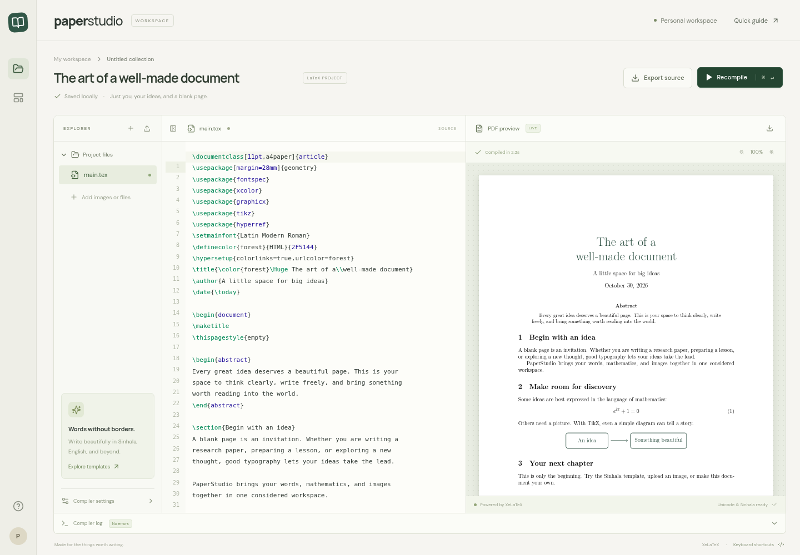

# PaperStudio

A React workspace for writing LaTeX and compiling real PDFs with XeLaTeX. Includes a CodeMirror source editor, PDF preview, compiler logs, local autosave, source import/export, image uploads, and Sinhala typography.



## Run locally

Requires Node.js 22+ and a TeX Live installation with XeLaTeX. On Debian/Ubuntu:

```sh
sudo apt-get update
sudo apt-get install -y texlive-xetex texlive-latex-extra texlive-pictures fonts-noto-core fonts-lmodern poppler-utils
npm ci
npm run dev
```

Vite serves the development interface on port 5173 and proxies `/api` to the Node backend on port 3001. Open the Vite address printed in your terminal. No API keys or database are required.

For a production build on your personal machine:

```sh
npm run build
npm start
```

The backend serves both the built interface and API on port 3001. `PORT` changes its port; `HOST` changes its bind address (default `127.0.0.1`). Hosting requires a Node server and TeX Live; GitHub Pages cannot run the compiler.

## Write and compile

- Edit `main.tex`, then click **Recompile** or press **Ctrl/⌘ + Enter**. Two compilation passes resolve references and the table of contents.
- The PDF preview shows the last successful compilation. Download the PDF with the preview toolbar button.
- Open the compiler log for file/line errors. A failed compile retains the last good PDF.
- Upload PNG, JPEG, or PDF assets with the Explorer upload button. Select an asset and click **Insert into document**. Templates already load `graphicx`.
- Use the Templates button in the left rail for an editorial article, a Sinhala document, or a research report. Choosing a template replaces the source and assets; export your source first.
- Source and assets autosave in this browser's local storage. This is a single-project personal workspace; there is no account, cloud synchronization, or collaborative editing. Storage quotas vary; keep exported backups.
- Import `.tex` source with the Explorer plus button. Uploads are limited to 20 assets and 10 MB total. Source is limited to 512 KB.

### Sinhala and fonts

The compiler uses Unicode-aware XeLaTeX. For Sinhala:

```tex
\documentclass{article}
\usepackage{fontspec}
\setmainfont{Noto Serif Sinhala}
\begin{document}
ආයුබෝවන්! මෙය සිංහල ලේඛනයකි.
\end{document}
```

`Noto Sans Sinhala` is also supported when installed. For mixed languages, define another font with `\newfontfamily\englishfont{Latin Modern Roman}` and use `{\englishfont English text}`. See the included Sinhala template and [compiled sample](examples/sinhala.pdf).

PNG/JPEG/PDF images and TikZ graphics work through standard LaTeX packages. SVG/EPS conversion, custom font uploads, multi-file `.tex` projects, BibTeX/Biber, and shell-escape tools such as minted are not supported by this version. Additional LaTeX packages must be installed on the backend.

## Validation

```sh
npm run build
npm test
# With the built app running via npm start:
node scripts/browser-smoke.mjs
```

The integration tests compile all three templates, inspect extracted PDF text and embedded Sinhala fonts, include an uploaded image, exercise LaTeX errors, and check asset validation and absolute-file-read restrictions. Tests require `pdftotext`, `pdffonts`, and Python 3. Browser checks use system Chromium (`CHROMIUM_PATH` overrides `/usr/bin/chromium`) and verify compilation, preview, autosave, logs, and mobile layout. `APP_URL` overrides the local backend address.

## Structure

```text
src/components/SourceEditor.jsx   CodeMirror LaTeX editor
src/components/PDFPreview.jsx    PDF.js canvas and selectable text viewer
src/components/CompilerLog.jsx   Expandable compiler diagnostics
src/App.jsx                      Project workspace and asset management
src/templates.js                 English, Sinhala, and research templates
server/compiler.js               XeLaTeX execution and temporary-file lifecycle
server/index.js                  HTTP API and production static serving
```

## Compiler deployment boundary

Run this as a personal workspace with trusted LaTeX documents. Shell escape is disabled, restrictive TeX input/output settings are enabled, every compilation uses a temporary directory that is removed afterward, and there are limits on request size, concurrent jobs, log size, and execution time. These measures are **not an operating-system security sandbox**. Do not expose this unauthenticated compiler to untrusted users or the public Internet. Public/multiuser hosting needs authentication and per-job OS/container isolation with resource limits, no credentials, and no network access. The API does not enable cross-origin access; requests must use JSON.

Interface fonts are bundled locally; compilation does not require an external PDF service.
